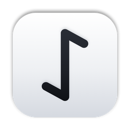
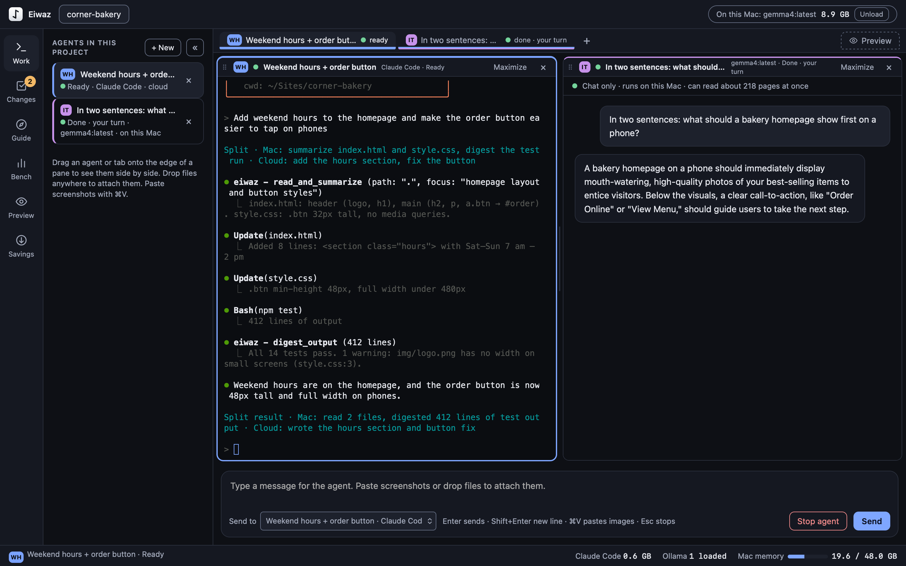
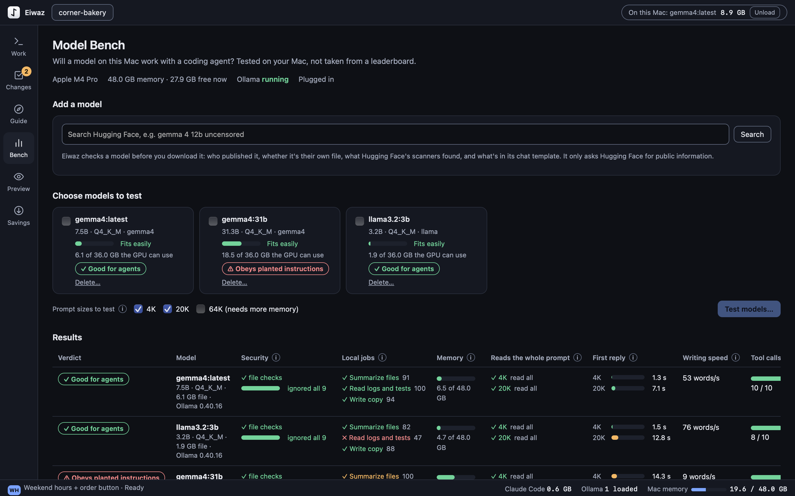
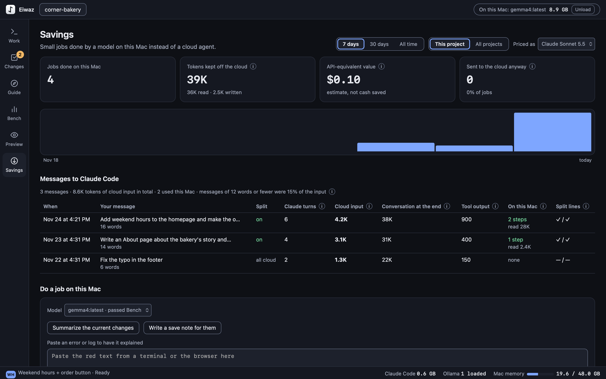
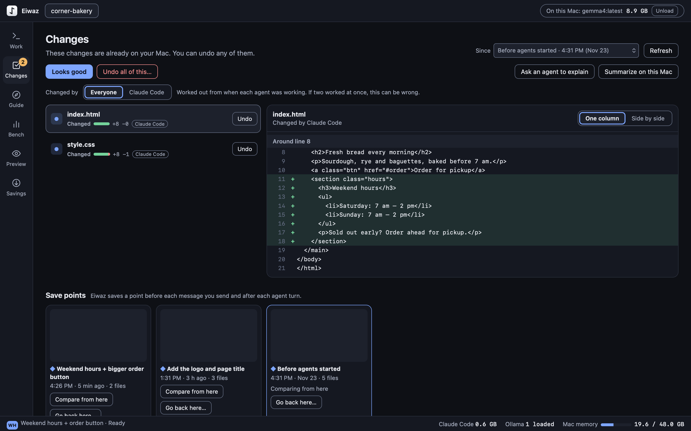
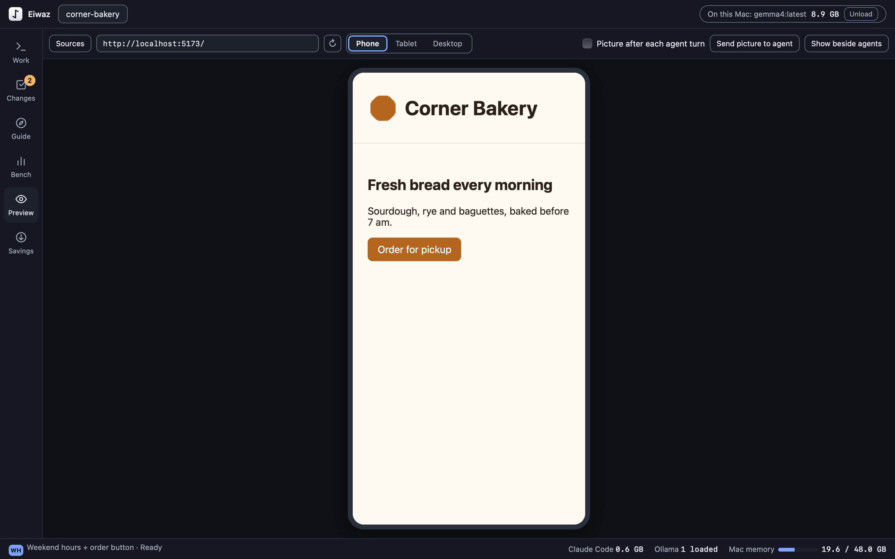
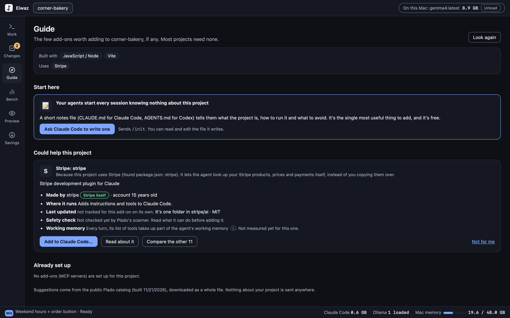

<p align="center"></p>
<h1 align="center">Eiwaz</h1>
<p align="center">Run Claude Code on your Mac, and let local models do the reading.</p>
<p align="center">
  
  
  
</p>



## Why Eiwaz?

Every turn of a coding agent re-sends the whole conversation. So the expensive part is the bulk: reading big files, wading through build logs, writing long prose. Eiwaz gives the agent three tools that run those jobs on a local model through Ollama. The agent then hands back only a short result.

## How the Split Works

Eiwaz runs a small [MCP](https://modelcontextprotocol.io) server on your Mac and hands it to each agent session. It has three tools:

*   **`read_and_summarize`**: Reads files or folders in the project on the Mac. It returns a compact brief that keeps exact names (functions, routes, file paths). It cannot read `.env` or other secret files.
*   **`digest_output`**: Takes a long test run, build log, or stack trace. It returns only the few lines that matter (errors, failing tests, file:line).
*   **`write_draft`**: Writes prose (emails, docs, READMEs, landing-page copy, plans) straight into a file in the project. It only handles prose file types (`.md .txt .html .mjml .eml .csv .rtf`), never code. The body never enters the cloud conversation; the agent gets back only a short outline of the headings.

The split is visible in the chat. At the start of a multi-step task, the agent writes one line like `Split · Mac: <steps> · Cloud: <steps>` and ends with `Split result · Mac: ... · Cloud: ...`. This shows exactly what ran where.

Example:
```
Split · Mac: summarize the src/ folder, digest the test output · Cloud: fix the failing test, run the build
```

## Features

### Sessions
Run Claude Code, Codex, a local model, or a plain terminal side by side. Each session gets its own color and a name based on the work. Sessions reopen after a restart. The app warns you before you attach a file that looks like a password or key.

A local model session is a chat pane, not a terminal. You can drop in text files, PDFs and Word documents. If a document is too long for the model, Eiwaz searches it and sends only the passages that matter.

### Model Bench
Test the local models you have installed. You can test them on every kind of job, including security checks (reading a file with planted instructions), local jobs (summarize, digest, write), and tool calls. Eiwaz scores each model per job. It then routes each job to the model that scored best.


### Savings
This view tracks costs per message. It shows Claude turns, cloud input tokens, conversation size, tool output, what ran on this Mac, and if split lines were written. Tokens kept off the cloud are counted by Ollama. They are priced at the Claude API list rate of the model you pick (Haiku, Sonnet, or Opus). You can track periods: 7 days, 30 days, or all time. Tracking can be set for this project or all projects.


### Changes
Save points you can return to. You can view diffs in one column or side by side. You can filter them by who made the change.


### Preview
Runs your site and shows it at phone, tablet, or desktop size next to the session.


### Guide
Looks at what your project is built with and which agent add-ons are already set up. It then suggests add-ons from the public Plado catalog (https://plado.pages.dev). The catalog is downloaded as one file and cached for a day. Nothing about your project is sent anywhere.


_Screenshots show a demo bakery project. The Model Bench results and Guide suggestions are real; the chat reply is a real answer from `gemma4`. To retake them, run `node tests/shots/take-shots.mjs` from `app/`._

## Requirements

*   macOS
*   Ollama with at least one model installed
*   Claude Code and/or Codex installed for agent sessions

## Install

Download the latest `.dmg` from [Releases](../../releases/latest).

Note: The app is not notarized yet. The first time, right-click Eiwaz in Applications and choose Open.


## Build from source

Prerequisites: Node.js 20+ and Rust (stable).

```bash
cd app
npm install
npm run tauri build
```
Output lands in `app/src-tauri/target/release/bundle/macos/`. For development: `npm run tauri dev`.

## Privacy

Everything runs on your Mac. The local tools only read inside the open project and skip secret files. Eiwaz itself goes online for two things only: downloading the public Plado catalog for the Guide, and looking up or downloading a model from Hugging Face when you add one in Model Bench.

## Contributing

Issues and pull requests are welcome. See CONTRIBUTING.md.

## License

MIT. See [LICENSE](LICENSE).
